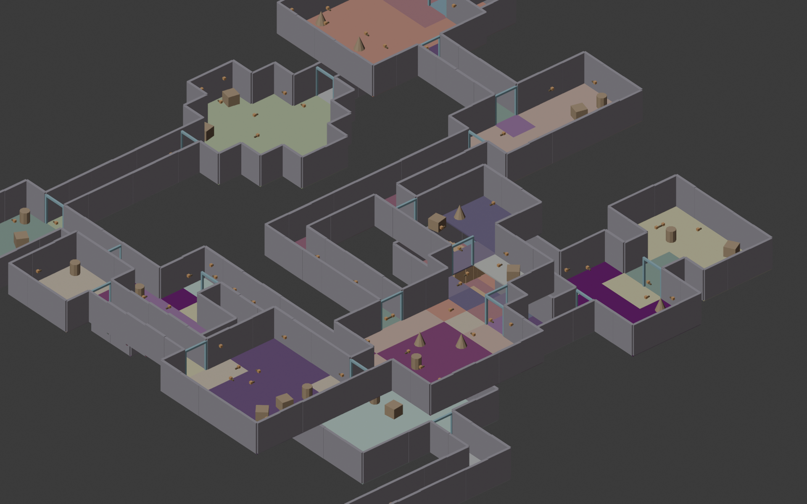

# Game Level Architect

Procedural game-level generator for Blender: a Wave-Function-Collapse-style room/corridor/stair
layout solver paired with automatic mesh generation (Geometry Nodes for floors, baked Python mesh
for walls and stairs).

**Watch it generate:** [docs/showcase.mp4](docs/showcase.mp4) — Generate Blueprint, Separate by
Floor/Room (real per-room color), Cave Mode's organic tunnels, a full populated level, and
Per-Floor Overrides, ~19 seconds.

<video src="docs/showcase.mp4" controls width="100%"></video>

**Status: early testing release.** Feedback welcome, expect rough edges.

License: GPL-3.0-or-later (see `game_level_architect/LICENSE`).

## Requirements

- Blender 4.2 LTS or newer (tested through 5.2).

## Installing

1. Download `game_level_architect.zip` (don't unzip it).
2. In Blender: **Edit > Preferences > Add-ons > Install from Disk...**, then pick the zip.
   (On some Blender builds you can also just drag the zip into the 3D viewport.)
3. Enable **Game Level Architect** in the add-ons list if it isn't already checked.
4. Open the 3D Viewport sidebar (press **N**) and find the **Level Architect** tab.

The `Textures/` folder bundled inside the zip must stay next to the add-on's Python file — it's
used for the built-in flat-color material set. If you ever move the installed add-on folder by
hand, move `Textures/` along with it.

## Tutorials

- **Getting Started** ([docs/tutorial_getting_started.mp4](docs/tutorial_getting_started.mp4),
  ~2:23) — walks through all 5 steps in order (Blueprint → Walls → Stairs → Doors → Props) plus
  Separate by Floor/Room, on one level built up step by step, with captions pointing at which
  panel setting to use.

## Basic workflow

The panel is organized into tabs (Setup / Walls / Stairs / Doors / Props, icon row at the top) —
each tab holds that step's settings and its own Generate button, so only one step's settings show
at a time. A persistent Debug section stays at the bottom regardless of which tab is open. The
five steps build on each other's output in order:

1. **Step 1: Generate Blueprint** — builds the room/corridor/stair layout and the floor mesh
   (via a Geometry Nodes modifier). Optional continuous room elevation and Corridor Stairs are
   both configured here too, before generating.
2. **Step 2: Generate Walls** — builds wall geometry from the blueprint's layout. Optional
   "Per Floor" grouping splits walls into one object per floor.
3. **Step 3: Generate Stairs** — builds stair geometry (stepped stairs or a smooth ramp).
   "Per Floor" or "Per Stair" grouping controls how many separate objects you get.
4. **Step 4: Generate Doors** — walk-through door frames at every point a corridor enters a
   room or two rooms meet directly (no panel, just a frame — nothing to open/close yet).
5. **Step 5: Generate Props** — wall-mounted torches (each with a real light, not just a mesh)
   and scattered crate/barrel/cone decoration placeholders, organized into their own
   "Procedural Level Props" collection so they can be hidden or deleted independently of the
   structural geometry.

**Add Ceiling** (under Scale & Style) closes every room's ceiling instead of leaving it open —
turn this on for an FPS-style playtest so rooms don't open onto empty space overhead. It's a live
Geometry Nodes toggle, so it can be flipped after generating without re-running Step 1, and
Isometric Mode automatically hides it again for a dollhouse-style top-down view.

**Separate by Floor/Room** (next to Step 1) splits the blueprint mesh into one object per room
plus a combined corridor object per floor, organized into a collection tree (Floor N > Rooms /
Corridors) so a room or a floor's corridors can be hidden, isolated, or exported on their own.
Run it directly on the Step 1 object — it reads the still-live Geometry Nodes modifier itself,
no need to apply it first (doing that manually beforehand, via Object > Apply > Visual Geometry
to Mesh, actually breaks per-room coloring on the result — Blender's own Convert/Apply drops the
material list for this kind of setup, so let this button do that step instead).

Regenerating Step 1 rebuilds the whole layout from scratch (new seed unless "Random Seed" is
turned off); Steps 2-5 can each be re-run independently after tweaking their own settings without
regenerating the blueprint.

## Reporting issues

This is a testing release — if something looks wrong (stairs, walls, connectivity, materials),
note your generation settings (map size, room/stair counts, seed) along with what you saw, since
generation is fully seeded and reproducible. The panel's **Debug: Last Generation Params**
section has a **Copy Parameters** button that grabs the exact settings for you.

See `CHANGELOG.md` (next to this file) for version history and currently known issues before
reporting — your case might already be a documented tradeoff rather than a new bug.
