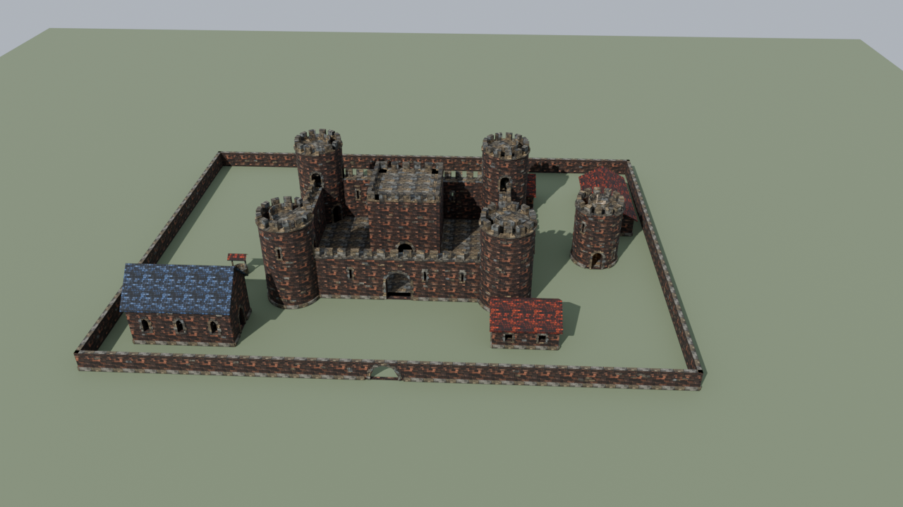
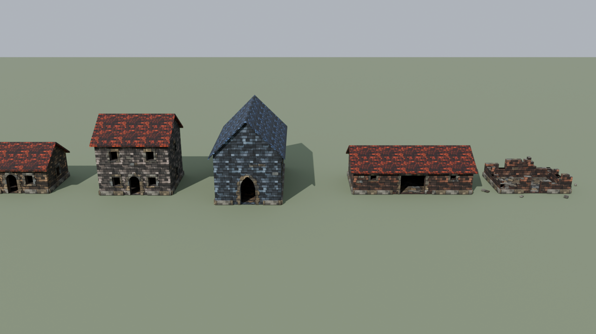

<meta property="og:title" content="Game Level Architect">
<meta property="og:description" content="Procedural game-level generator for Blender — a WFC-style room/corridor/stair solver with automatic Geometry Nodes + Python mesh generation.">
<meta property="og:image" content="https://raw.githubusercontent.com/dottyboy/BlenderLevelArchitect/main/screenshot.png">
<meta property="og:url" content="https://github.com/dottyboy/BlenderLevelArchitect">
<meta property="og:type" content="website">

<meta name="twitter:card" content="summary_large_image">
<meta name="twitter:title" content="Game Level Architect">
<meta name="twitter:description" content="Procedural game-level generator for Blender — a WFC-style room/corridor/stair solver with automatic Geometry Nodes + Python mesh generation.">
<meta name="twitter:image" content="https://raw.githubusercontent.com/dottyboy/BlenderLevelArchitect/main/screenshot.png">

# Game Level Architect

**Procedural dungeons, towers and castles for Blender** — a Wave-Function-Collapse-style room/corridor/stair solver with
brick-textured masonry, real doors and windows, spiral-stair towers, ruins, and engine-ready glTF packages.

## What you get

| | |
|---|---|
| **Layouts** | Rooms, corridors, stairs over several floors and sub-levels. Rectangular, Round, Mixed and Cave rooms, bent stairwells, Corridor Stairs, continuous elevation. Fully seeded and reproducible. |
| **Masonry** | Brick- and stone-textured walls (procedural normal maps, a few thousand vertices instead of thousands of modelled bricks), stone door frames and framed windows, a different brick colour per room. |
| **Structures** | A round **Tower** (spiral stairs, railing, lanterns, furniture) and a walled **Castle** (four towers, wall walk, gate, furnished keep). |
| **Ruins** | One slider breaks towers, castles and walls down: stepped jagged tops, breaches, collapsed arches, rubble. Doorways stay passable. |
| **Doors, windows, props** | Arched / pointed / flat doors with swinging panels, windows with glass, torches with real lights, themed furniture. |
| **Plans** *(experimental)* | Describe a site as a nested plan (castle grounds with a castle and a watchtower), store it in the .blend and as JSON, rebuild it any time. First step towards farms, villages and towns — see [the roadmap](docs/WORLD_GENERATOR_PLAN.md). |
| **Engine export** | glTF/GLB, collision mesh, and **game packages**: glb + JSON of walkable areas, rooms, stairs, lights and props — per floor if you like. |
| **Tested** | 500+ automated checks (ray-cast passability, normals, vertex budgets, round-trips) on Blender 4.2 LTS, 5.2.1 and 5.2.2. |

## Gallery

<table>
<tr>
<td width="50%"> A generated level — every room its own brick tint, windows, doors, torches, themed furniture</td>
<td width="50%"> Round rooms with masonry rings and arched openings</td>
</tr>
<tr>
<td> The Castle, <i>Mixed</i> brick colours</td>
<td> The same generator with the <i>Ruin</i> slider up</td>
</tr>
<tr>
<td> Towers at Ruin 0.3 / 0.6 / 1.0</td>
<td> A tower cut open: floors, spiral stairs with railing, furniture</td>
</tr>
</table>

<table>
<tr>
<td width="33%"> The <b>Ruin</b> slider, 0 → 1</td>
<td width="33%"> The brick colours</td>
<td width="33%"> Eight seeds, one click each</td>
</tr>
</table>

### In a game

The *Game Package* export feeds a real engine: the sibling project *Vampire Adventure* (Godot) loads packages as playable
locations — walkable by rectangles, torches as real lights, doors that swing open, stairs that fade between floors.

<table>
<tr>
<td width="50%"> A generated catacomb in the game</td>
<td width="50%"> The generated castle's gate</td>
</tr>
</table>

## Plans: from one building to a site (experimental)

A **plan** describes a site as nested data — a fortress, a farmyard, later a village — and the generator builds it. Plans live
in the .blend and as `.plan.json`, are fully seeded, and can place buildings for you.

<table>
<tr>
<td width="50%"> <b>Fortress</b> — outer ward with corner towers and a gate, the castle as its keep</td>
<td width="50%"> <b>Castle grounds</b> — chapel, stable, houses, well and watchtower laid out automatically</td>
</tr>
<tr>
<td colspan="2"> Building plans: house, two-storey house, chapel (slate roof), stable, ruin</td>
</tr>
</table>

* **Building plans**: tower, castle, house, chapel, stable, well — masonry walls, doors, windows, terracotta or slate roofs, ruin.
* **Compound plans**: a footprint with a stone enclosure and gate, and `layout` rules ("1 chapel on the wall, 1-2 stables, 3 houses")
  that place buildings without overlap, keep the way from the gate to the castle free and turn doors toward it.
* In Blender: sidebar **Level Architect > Plans (experimental)** — pick Tower, Castle, Grounds, Fortress, House, Chapel or
  Stable at the 3D cursor, then **Build**. Format: [docs/PLAN_FORMAT.md](docs/PLAN_FORMAT.md); roadmap towards farms, villages,
  towns, culture styles and biomes: [docs/WORLD_GENERATOR_PLAN.md](docs/WORLD_GENERATOR_PLAN.md).

## Install

1. Download `game_level_architect.zip` from the [Releases page](https://github.com/dottyboy/BlenderLevelArchitect/releases/latest) (don't unzip it).
2. In Blender: **Edit > Preferences > Add-ons > Install from Disk…** and pick the zip. Enable **Game Level Architect**.
3. Open the 3D Viewport sidebar (**N**) and find the **Level Architect** tab.

Requires **Blender 4.2 LTS or newer** (tested on 4.2.21, 5.2.1 and 5.2.2). The bundled `Textures/` folder must stay next to the add-on file.

## Quick start

1. **Setup** tab → pick a Preset or set a map size.
2. **Walls** tab → Wall Style *Masonry*.
3. Press **Generate All Steps** (or run Step 1–5 one by one: Blueprint, Walls, Stairs, Doors, Props).
4. **Structures** tab (choose Tower or Castle) → move the 3D cursor → **Generate**.
5. **Export** tab → **Export Level (glTF/GLB)** or **Export Game Package**.

The full walkthrough is the **[User Guide](docs/USER_GUIDE.md)**.

## The panel at a glance

| Tab | What it does |
|---|---|
| **Setup** | Map & seed, rooms, room shape, floors and sub-levels, elevation, scale, style, **Step 1** |
| **Walls** | Wall Style (Boxes / Masonry), Room Brick Colors, Wall Ruin, windows, Round-room walls, **Step 2** |
| **Stairs & Doors** | Stair style, bends, grouping (**Step 3**); door style, height, frames, swinging panels (**Step 4**) |
| **Props** | Torches and lights, decoration, themes, **Step 5** |
| **Export** | glTF/GLB, collision mesh, game packages (whole level or per floor) |
| **Structures** | Switch between **Tower** (size, door, windows, interior stairs/railing/lanterns/furniture, Brick Color, Ruin) and **Castle** (size, towers, gate, keep, hall furniture, Brick Color, Ruin, castle package export) |

## Tutorials

Short screen recordings (they predate the masonry, tower and castle features, but the core workflow is unchanged):

- **Showcase** — [docs/showcase.mp4](docs/showcase.mp4), ~19 s
- **Getting Started** — [docs/tutorial_getting_started.mp4](docs/tutorial_getting_started.mp4), 2:23 — all five steps in order
- **Room Shapes & Corridor Stairs** — [docs/tutorial_room_shapes.mp4](docs/tutorial_room_shapes.mp4), 2:07
- **Materials & Per-Floor Overrides** — [docs/tutorial_materials.mp4](docs/tutorial_materials.mp4), 2:02
- **Props & Lighting** — [docs/tutorial_props_lighting.mp4](docs/tutorial_props_lighting.mp4), 2:03

## More documentation

| | |
|---|---|
| [User Guide](docs/USER_GUIDE.md) | How to use every tab, with tips |
| [CHANGELOG.md](CHANGELOG.md) | Version history and known issues |
| [DEVELOPMENT.md](DEVELOPMENT.md) | Architecture, design decisions, how things are tested |
| [CONTRIBUTING.md](CONTRIBUTING.md) | Reporting bugs and contributing |
| `tools/` | Scripts that render the pictures and animations on this page |

## Known limitations

* A tower's interior is one floor per storey connected by one spiral stair; the castle's tower floors are not yet part of the
  game package's walkable ground.
* Upper floors of a multi-floor game package are separate packages (one location per floor), not one continuous level.
* On UPBGE, "Hinge Physics" for door panels is experimental and unverified in a live session.
* Early testing release — expect rough edges. Generation is fully seeded, so bug reports with settings are easy to reproduce
  (*Debug: Last Generation Params > Copy Parameters*).

## License

GPL-3.0-or-later — see [LICENSE](LICENSE).
